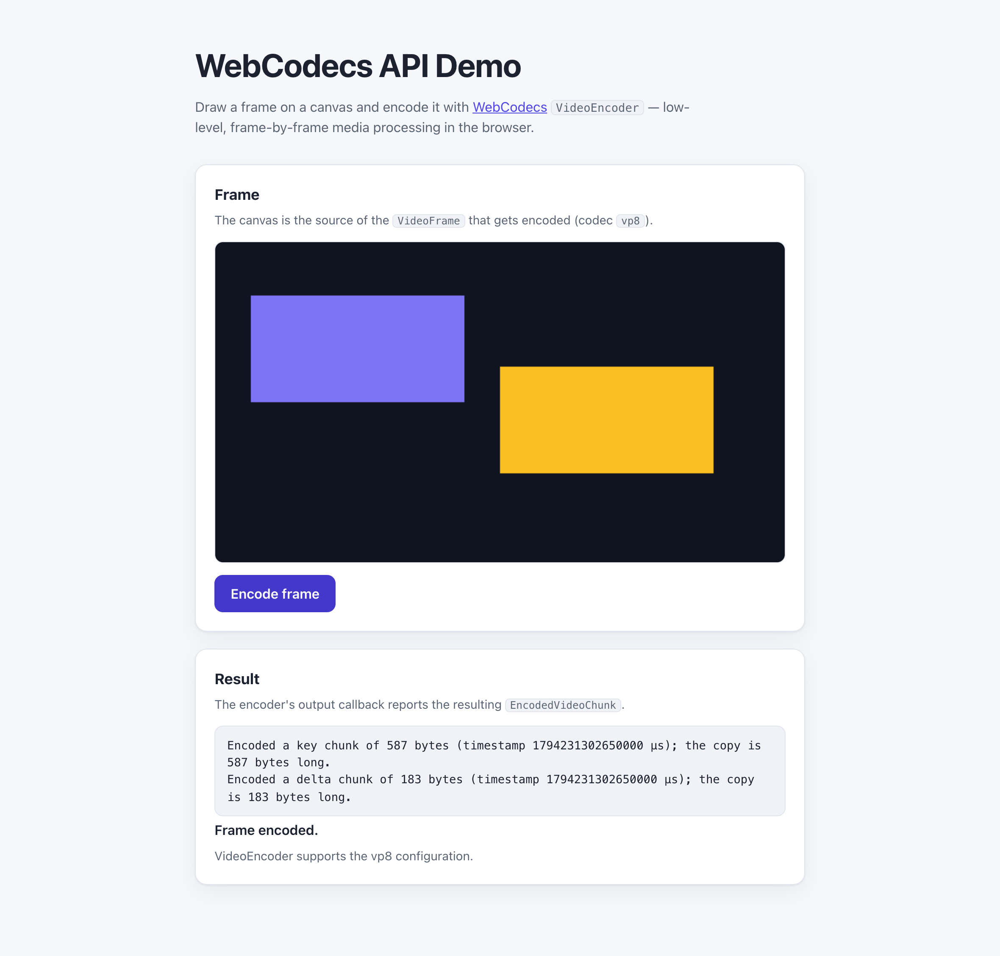

# WebSharper.WebCodecs

[](https://github.com/dotnet-websharper/WebCodecs)

WebSharper bindings for the [WebCodecs API](https://developer.mozilla.org/en-US/docs/Web/API/WebCodecs_API) —
low-level, frame-by-frame access to the browser's audio and video encoders and decoders
from F# and C# web apps.

WebCodecs is only available in [secure contexts](https://developer.mozilla.org/en-US/docs/Web/Security/Defenses/Secure_Contexts)
(HTTPS or localhost), and codec support varies by browser and platform.

This repository contains:

| Project | Purpose |
| --- | --- |
| `WebSharper.WebCodecs` | The binding: WIG definitions for `VideoEncoder`/`VideoDecoder`, `AudioEncoder`/`AudioDecoder`, `ImageDecoder`, `VideoFrame`, `AudioData`, the `Encoded*Chunk` and `*Metadata` types, and their option dictionaries. |
| `WebSharper.WebCodecs.Sample` | An ASP.NET Core SPA that draws a canvas frame and encodes it with `VideoEncoder`. |

## Live demos

**Try it live:** [Open the sample in your browser](https://dotnet-websharper.github.io/WebCodecs/)



The sample doubles as the binding's [test case](#running-the-sample): it draws a canvas frame, encodes it with `VideoEncoder`, and reports the resulting `EncodedVideoChunk`.

- **Sample (this repository):** <https://dotnet-websharper.github.io/WebCodecs/>
- **Source repository:** <https://github.com/dotnet-websharper/WebCodecs>
- **WebSharper bindings:** <https://websharper.com/bindings>

## Features

- `VideoEncoder` / `VideoDecoder` for compressing and decompressing `VideoFrame`s and `EncodedVideoChunk`s.
- `AudioEncoder` / `AudioDecoder` for `AudioData` and `EncodedAudioChunk`s.
- `ImageDecoder` for decoding still and animated images frame by frame.
- `VideoFrame` (from an image source or raw pixel data, with `clone()`, `copyTo()` and `allocationSize()`).
- Typed option dictionaries: `VideoEncoderConfig`, `VideoEncoderEncodeOptions`, `VideoDecoderConfig`,
  `AudioEncoderConfig`, `AudioDecoderConfig`, `EncodedVideoChunkInit`, `EncodedAudioChunkInit`, and more.
- Metadata types: `EncodedVideoChunkMetadata` (with `decoderConfig`) and `EncodedAudioChunkMetadata`.

## Installation

The binding is not currently published to NuGet. Reference the project from source:

```bash
git clone https://github.com/dotnet-websharper/WebCodecs.git
```

```xml
<ItemGroup>
  <ProjectReference Include="path/to/WebSharper.WebCodecs/WebSharper.WebCodecs.fsproj" />
</ItemGroup>
```

## Usage

```fsharp
namespace WebSharper.WebCodecs.Demo

open WebSharper
open WebSharper.JavaScript
open WebSharper.WebCodecs

[<JavaScript>]
module Demo =
    let encodeCanvas (canvas: HTMLCanvasElement) =
        promise {
            let config =
                VideoEncoderConfig(
                    codec = "vp8",
                    Width = 640,
                    Height = 360,
                    Bitrate = 500000
                )

            let! support = VideoEncoder.IsConfigSupported(config)
            if not support.Supported then
                Console.Log("The vp8 configuration is not supported.")
            else
                let encoder =
                    new VideoEncoder(
                        VideoEncoderInit(
                            output =
                                (fun (chunk: EncodedVideoChunk) _metadata ->
                                    // Inspect the encoded bytes via copyTo().
                                    let bytes = Uint8Array(chunk.ByteLength)
                                    chunk.CopyTo(bytes)
                                    Console.Log($"Encoded {chunk.Type} chunk: {chunk.ByteLength} bytes")),
                            error = fun err -> Console.Error("Encoding error:", err?message)
                        )
                    )

                encoder.Configure(config)

                // Timestamps are expressed in microseconds.
                let frame = new VideoFrame(canvas, VideoFrameInit(Timestamp = float (Date.Now() * 1000)))
                encoder.Encode(frame)
                frame.Close()

                do! encoder.Flush()
                encoder.Close()
        }
```

The `output` callback of `VideoEncoderInit` receives an `EncodedVideoChunk` and an
`EncodedVideoChunkMetadata` (the latter may be undefined). The callback of `AudioEncoderInit`
receives an `EncodedAudioChunk` and an `EncodedAudioChunkMetadata`.

## Running the sample

Build the sample in Release and serve its static output:

```bash
dotnet build WebSharper.WebCodecs.Sample/WebSharper.WebCodecs.Sample.fsproj -c Release
python3 -m http.server -d WebSharper.WebCodecs.Sample/wwwroot 5608
```

Open <http://localhost:5608/>. Localhost counts as a secure context, so WebCodecs is available.
Click **Encode frame** to draw a frame on the canvas, encode it with `VideoEncoder` (codec `vp8`),
and see the resulting `EncodedVideoChunk` reported below.

Alternatively, run the ASP.NET Core host:

```bash
dotnet run --project WebSharper.WebCodecs.Sample
```

## Building from source

### Prerequisites

- [.NET SDK 10](https://dotnet.microsoft.com/download) or later.

### Build

```bash
dotnet tool restore
dotnet paket install
dotnet build WebSharper.WebCodecs.sln -c Release
```

The binding project targets `netstandard2.0`; the sample targets `net10.0`.

## Deployment

Pushing to `main` triggers `.github/workflows/ghpages.yml`, which builds the sample in Release
and publishes `WebSharper.WebCodecs.Sample/wwwroot` to the `gh-pages` branch.

## Repository layout

```
WebSharper.WebCodecs/              # binding (WIG definitions)
  Main.fs
WebSharper.WebCodecs.Sample/       # ASP.NET Core SPA demo
  Client.fs
  Startup.fs
  wwwroot/
    index.html
    site.css
.github/workflows/ghpages.yml      # build + deploy the sample to GitHub Pages
nuget/WebSharper.WebCodecs.paket.template
paket.dependencies
```

## Notes on the API

- **Secure context:** WebCodecs is only exposed in secure contexts. Serve the page over HTTPS or
  from localhost.
- **Codec support:** `VideoEncoder.IsConfigSupported(config)` returns a promise with a
  `Supported` flag and the normalized `Config`; always check it before configuring an encoder.
- **Timestamps:** media timestamps (`VideoFrame.timestamp`, `EncodedVideoChunk.timestamp`,
  `AudioData.timestamp`) are expressed in **microseconds**. Use `Date.Now() * 1000` for a
  wall-clock timestamp.
- **Chunk init types:** `EncodedAudioChunkInit` requires `type`, `timestamp` and `data`, and
  optionally takes `duration` and `transfer`. `EncodedVideoChunkInit` is a separate option
  dictionary with the same required/optional shape.
- **Metadata:** the video encoder's output callback receives an `EncodedVideoChunkMetadata`
  (`decoderConfig`, `alphaSideData`, `svc`); the audio encoder's receives an
  `EncodedAudioChunkMetadata` (`decoderConfig`).
- **Resource management:** `VideoFrame`, `AudioData`, `EncodedVideoChunk` and the encoder/decoder
  objects hold native resources; call `Close()` (or `clone()` before closing a shared frame) when
  you are done.

## License

Apache 2.0 — see [LICENSE.md](LICENSE.md).
